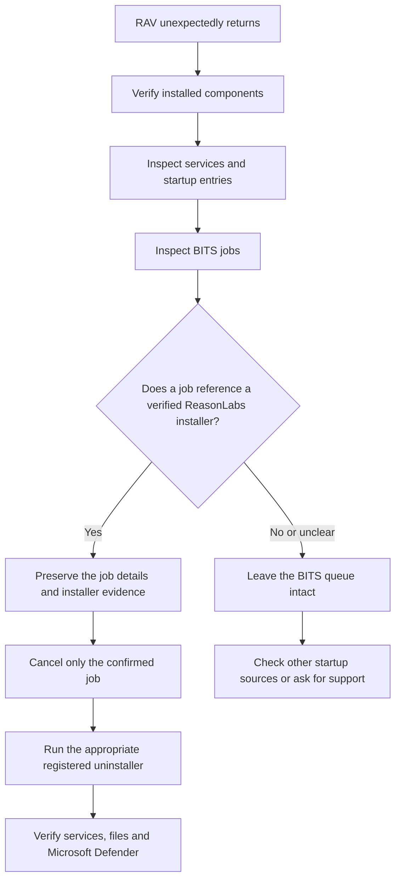

# RAV Endpoint Protection kept reinstalling on Windows 11

A single-device investigation of **ReasonLabs RAV Endpoint Protection 7.7.12**, its VPN, DNS and EDR components, and a Windows Background Intelligent Transfer Service (BITS) job named **DotSetup Installer**. The affected device was a Huawei laptop. All incident times use Windows local time, UTC+08:00.

The owner reported that ReasonLabs kept coming back after uninstalling it and removing uTorrent Web. On November 25, 2026, Process Monitor captured Windows BITS launching a signed ReasonLabs setup wizard in a uTorrent Web temporary folder. An elevated inventory independently found a saved BITS job configured to invoke that same file. This explains a relaunch path that existed outside the installed antivirus. A separate reinstall earlier that day is consistent with the same path, with its initiating process still unverified.

The owner canceled the matching job, preserved the installer copies, and used the registered vendor uninstaller. The active RAV components were absent in targeted checks after a normal restart. Microsoft Defender reported normal operation and real-time protection **before** that restart. A disabled service entry remained with its executable missing. The study covers one endpoint and does not establish behavior of all RAV packages.

| Start here | What it covers |
| --- | --- |
| [Removal guide](REMOVAL_GUIDE.md) | Read-only checks and how to remove a confirmed matching job |
| [Incident report](INCIDENT_REPORT.md) | Findings, remediation and limitations |
| [Technical analysis](TECHNICAL_ANALYSIS.md) | Process evidence, job settings and service integration |
| [Timeline](TIMELINE.md) | Chronological observations with record identifiers |
| [Evidence index](EVIDENCE_INDEX.md) | What supports each claim and how the excerpts were prepared |
| [Verification](VERIFICATION.md) | Defender and recurrence checks |
| [Privacy review](PRIVACY_REVIEW.md) | What was redacted or withheld |

| Publication details | Status |
| --- | --- |
| Report version | 1.0, release candidate |
| Author and copyright holder | 46n |
| GitHub owner | 46n |
| Initial research | November 25, 2026 |
| Initial publication | November 25, 2026 |
| Last updated | November 25, 2026 |
| Research scope | One affected Huawei Windows 11 laptop |
| Verification | Defender Normal with real-time protection before the last restart. Targeted checks found the active product footprint absent after one later normal restart. |
| Known limitations | BITS launch confirmed at 13:45. The parent behind the 12:54 installation remains inferential. No elevated post-restart Defender or all-users BITS snapshot, extended recurrence monitoring, or multi-device validation. |

## Troubleshooting at a glance

Follow the [removal guide](REMOVAL_GUIDE.md) before changing anything. See the [revision history](CHANGELOG.md) and [license notices](LICENSING.md).

Copyright © 2026 46n. Original documentation is licensed under [CC BY 4.0](licenses/CC-BY-4.0.md). Original PowerShell examples are licensed under the [MIT License](licenses/MIT.txt).

BITS is also used by legitimate Windows software. Inspect the actual notification executable and owner before changing any job. The [text-only excerpts](evidence/README.md) contain no binaries. Avoid posting full logs or running a cached installer to reproduce this case. See [references](references/SOURCES.md) for platform documentation.
