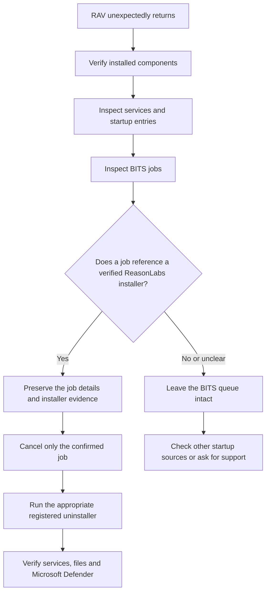

# If RAV Endpoint Protection keeps reinstalling

Use this guide when removal appears to succeed and the app later returns. On a managed PC, take the evidence to your administrator.

> [!CAUTION]
> **The documented BITS job belongs to this investigation.** Another PC can have a different job ID, installer location or persistence mechanism. Before canceling anything, verify the job's exact notification executable and confirm the file is the associated unwanted installer. Check its path and owner, and inspect its publisher and SHA-256 where available. A job name alone is insufficient.
>
> **Read-only:** Steps 1, 2 and 5 inspect Windows. **Changes Windows:** Step 3 cancels the confirmed job. Step 4 uninstalls software and describes scoped quarantine. Remove-BitsTransfer removes the selected job from the queue and can remove related temporary transfer files. Cancellation cannot be resumed like a pause.
>
> Keep the rest of the BITS queue intact. Never clear the whole queue or delete unrelated Windows services. If no job matches, or you are unsure about the file, leave BITS alone and investigate other startup sources.

## Troubleshooting flowchart

## 1. Identify what is present

Check **Settings → Apps → Installed apps** for RAV Endpoint Protection, RAV VPN, or Safer Web. In Windows PowerShell, check product directories and known service markers:

~~~powershell
$markers = 'ReasonLabs|Reason Cyber|Reason\.Snow|Safer Web|RAV VPN'
Get-CimInstance Win32_Service |
    Where-Object { "$($_.Name) $($_.DisplayName) $($_.PathName)" -match $markers } |
    Select-Object Name, DisplayName, State, StartMode, StartName, PathName

Test-Path -LiteralPath 'C:\Program Files\ReasonLabs'
Test-Path -LiteralPath 'C:\ProgramData\ReasonLabs'
~~~

If those checks fail with a permissions error, record it. See [verification](VERIFICATION.md) for task, startup and cache checks.

## 2. Inspect BITS without changing it

Open **Windows PowerShell as Administrator** to see jobs owned by all users. Keep the output private, especially the owner, full paths and download URLs.

~~~powershell
Get-BitsTransfer -AllUsers -ErrorAction Stop |
    Select-Object DisplayName, JobId, JobState, OwnerAccount, NotifyFlags, NotifyCmdLine, FileList |
    Format-List
~~~

Corroborate the matching executable, owner and GUID. The label DotSetup Installer by itself is insufficient. An ordinary update job with no ReasonLabs notification is unrelated to this case. If there is no match, stop before changing any job. If the cmdlet fails, document the error and ask for support. A current-user query can omit jobs visible only to administrators.

Record the notification, owner, state, time, publisher and hash before removal if the file is still available. Read file metadata without launching it. Where applicable, substitute the precise path already confirmed on your machine:

~~~powershell
$path = Read-Host 'Full path of the verified cached file'
Get-FileHash -LiteralPath $path -Algorithm SHA256 -ErrorAction Stop
Get-AuthenticodeSignature -LiteralPath $path |
    Select-Object Status, @{Name='Publisher'; Expression={$_.SignerCertificate.Subject}}
~~~

## 3. Cancel only the job you confirmed

Proceed only if the notification actually targets the unwanted installer, you recognize the scope, and you approve cancellation on your PC. Canceling removes the job from the queue and can remove associated temporary transfer files. It does not uninstall the application or necessarily remove a completed cached executable. If the owner, job or command changed between checks, pause and inspect again.

The optional command below queries all users, checks one selected GUID and compares the exact notification executable the reader supplies. It refuses to change anything without a second confirmation.

~~~powershell
$id = [guid](Read-Host 'Confirmed job GUID from your own PC')
$expected = Read-Host 'Exact verified notification executable path from your own PC'
if ([string]::IsNullOrWhiteSpace($expected)) { throw 'An exact path is required.' }

$job = @(Get-BitsTransfer -AllUsers -ErrorAction Stop |
    Where-Object JobId -eq $id)
if ($job.Count -ne 1) { throw 'Expected exactly one matching BITS job.' }

$actual = [string](@($job[0].NotifyCmdLine)[0])
if ($actual.Trim('"') -ine $expected) {
    throw 'Notification did not match the verified executable.'
}
$job[0] | Select-Object JobId, DisplayName, OwnerAccount, NotifyCmdLine | Format-List
if ((Read-Host 'Type CANCEL to remove this one job') -ceq 'CANCEL') {
    $current = @(Get-BitsTransfer -AllUsers -ErrorAction Stop |
        Where-Object JobId -eq $id)
    if ($current.Count -ne 1 -or
        $current[0].OwnerAccount -ne $job[0].OwnerAccount -or
        ([string](@($current[0].NotifyCmdLine)[0])).Trim('"') -ine $expected) {
        throw 'The job is absent or its owner or notification changed.'
    }
    Remove-BitsTransfer -BitsJob $current[0] -ErrorAction Stop
    $remaining = @(Get-BitsTransfer -AllUsers -ErrorAction Stop |
        Where-Object JobId -eq $id)
    if ($remaining.Count -ne 0) { throw 'A matching job remains.' }
    'The selected job is absent from the elevated inventory.'
}
~~~

Access denied, a missing job, a nonmatching command, or an unsuccessful follow-up query leaves the result unverified. Keep other jobs and the BITS database intact.

## 4. Use the registered uninstaller

Use **Settings → Apps → Installed apps → Uninstall** for the affected ReasonLabs products. Preserve relevant evidence and quarantine only the verified downloaded installer once the job is canceled. Keep the installed vendor uninstaller and its dependencies intact until uninstall finishes.

In this case, moving the installed setup stub too early made the registered uninstaller exit silently. Restoring the validated Program Files stub under approval allowed the vendor uninstall to run. Do not copy an unknown installer into Program Files or restore a flagged file as a generic fix. If the uninstaller fails, use the publisher's supported path or ask a qualified technician about the dependency. Do not execute the bundled cache manually.

Leave an access-denied orphan alone if you have verified it is stopped, disabled and points to a missing binary. Avoid force-deleting services, disabling Defender, altering service permissions, and broad registry deletion. If a verified vendor entry still runs or returns, collect fresh evidence first.

## 5. Verify before calling the issue resolved

Check Defender and the affected apps, service registrations, BITS notifications and network state. Repeat the checks after a normal restart and again after typical use. [Verification checklist](VERIFICATION.md) · [Microsoft references](references/SOURCES.md)
